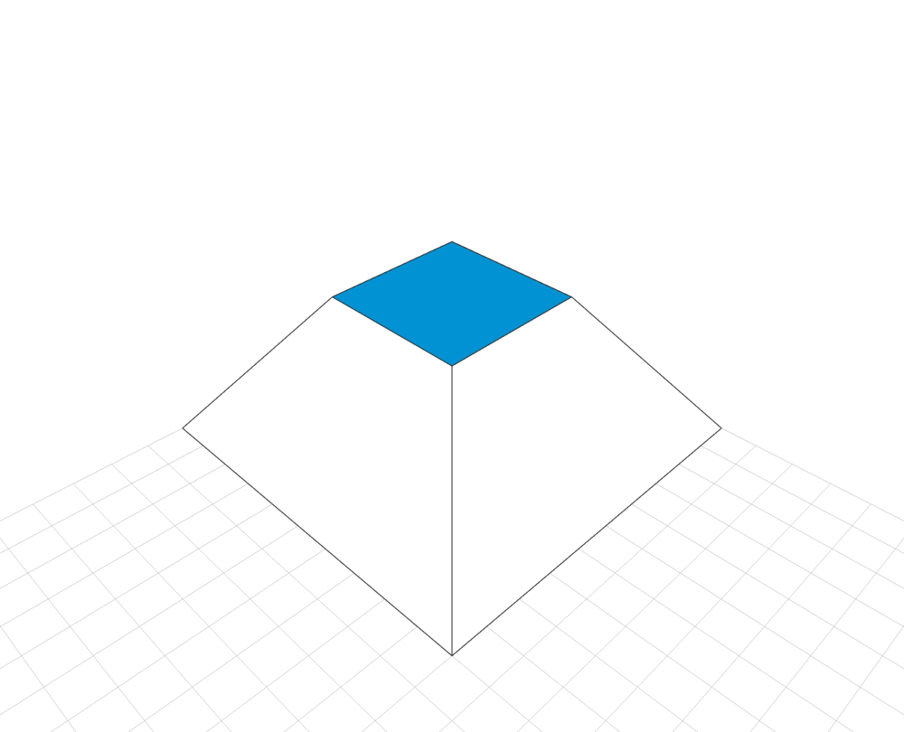

# Pull a face of a cell along its normal

The face moves to planes parallel to itself; its vertices slide along the neighbouring edges.



```python title="examples/cell_manipulation/00_10_cell_pull_face.py"
--8<-- "examples/cell_manipulation/00_10_cell_pull_face.py"
```
