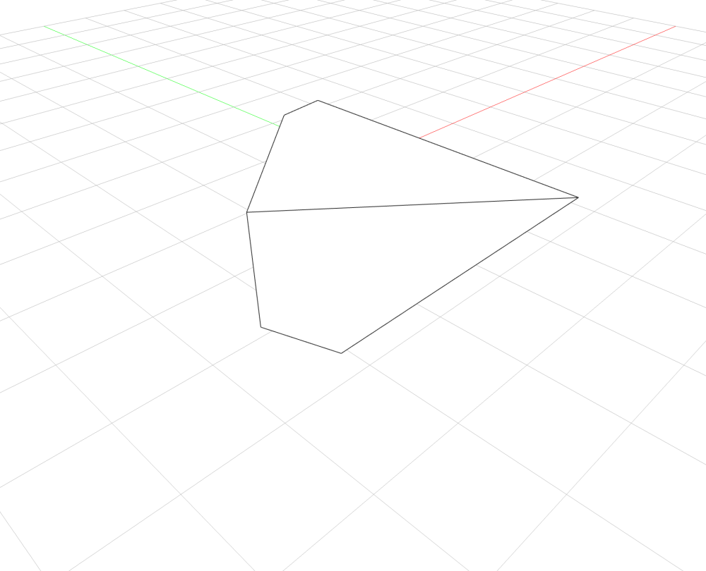

# Arearise one face of a cell: move it along its normal until it reaches a target area



```python title="examples/cell_manipulation/00_20_cell_arearise_face.py"
--8<-- "examples/cell_manipulation/00_20_cell_arearise_face.py"
```
