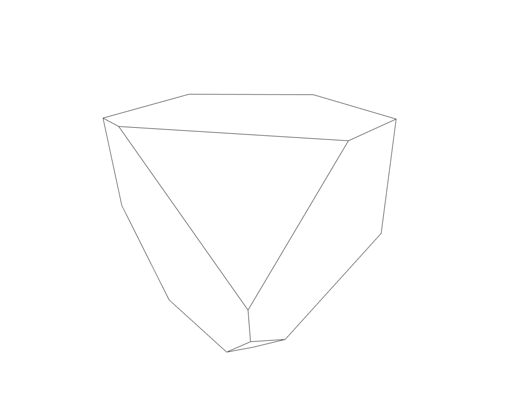

# Planarise the faces of a cell

The faces are coloured by their flatness relative to the start: red is as warped as at the
start, white is flat.



```python title="examples/cell_manipulation/00_40_cell_planarisation.py"
--8<-- "examples/cell_manipulation/00_40_cell_planarisation.py"
```
