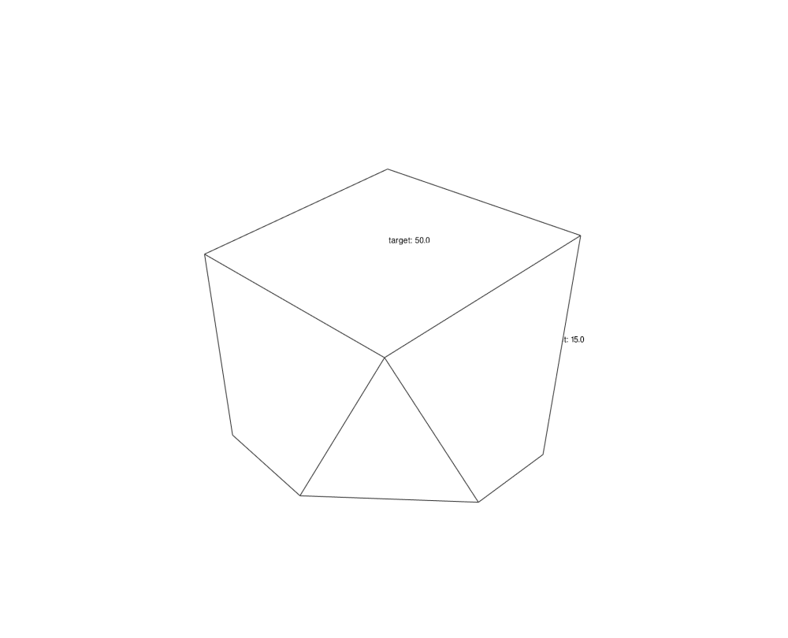

# Arearise several faces of a cell at once, optionally keeping all face normals fixed



```python title="examples/cell_manipulation/00_41_cell_arearisation.py"
--8<-- "examples/cell_manipulation/00_41_cell_arearisation.py"
```
