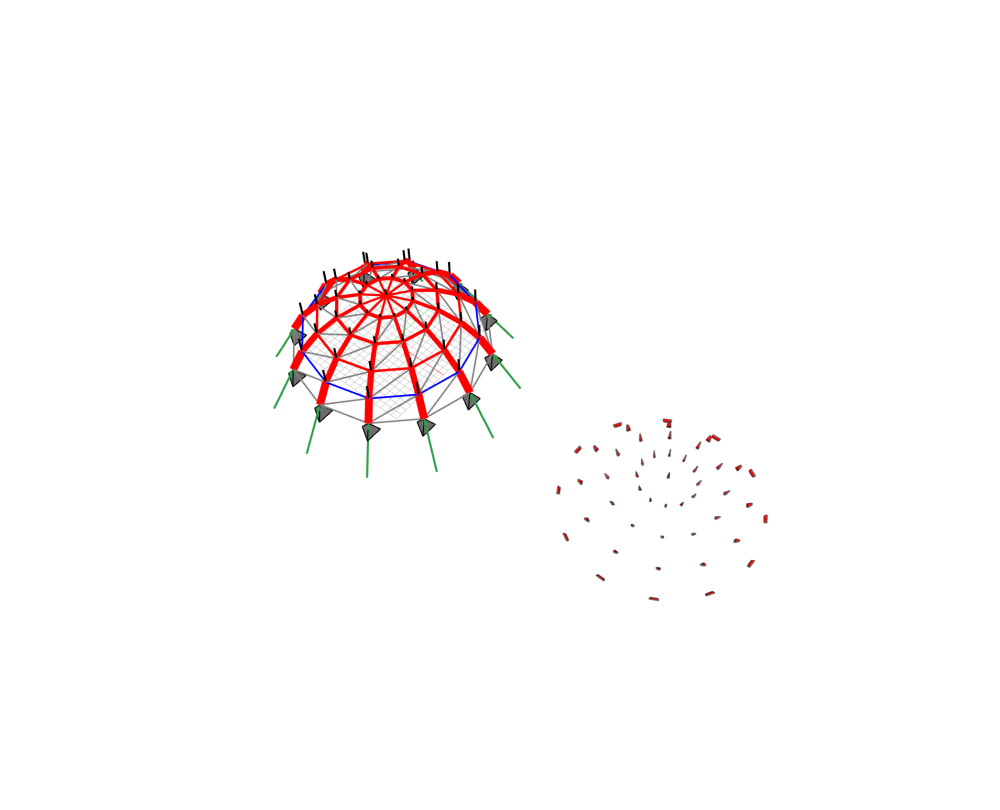

# A Schwedler dome: rings, meridians and one diagonal per panel, on a ring of pinned supports



```python title="examples/model/07_schwedler_dome.py"
--8<-- "examples/model/07_schwedler_dome.py"
```
