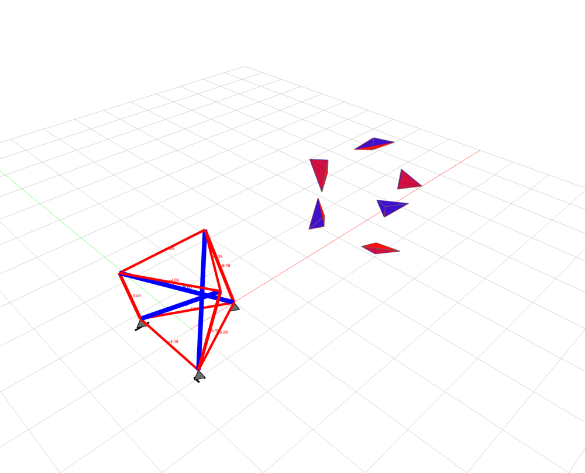

# A tensegrity prism: three struts held apart by nine cables, in equilibrium without any load



```python title="examples/model/08_tensegrity_prism.py"
--8<-- "examples/model/08_tensegrity_prism.py"
```
