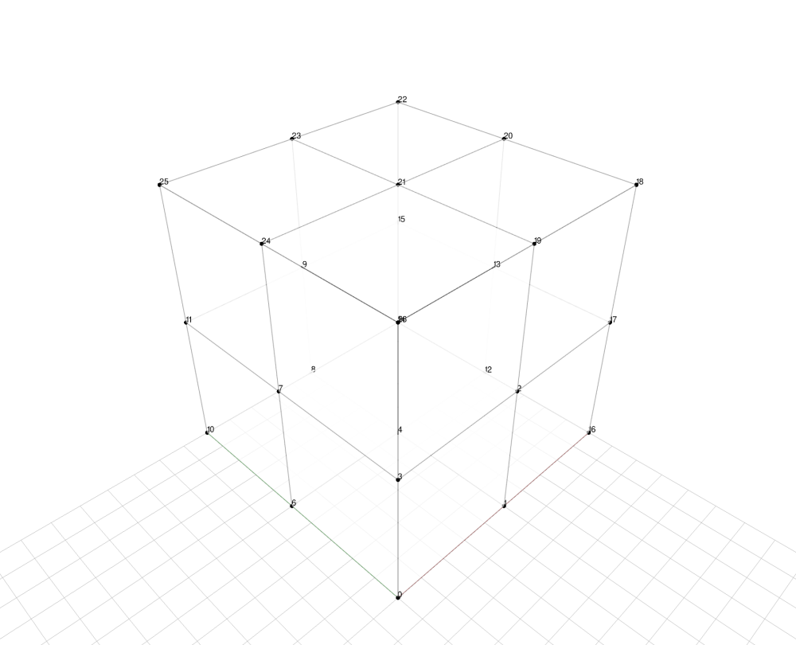

# Construct a force volmesh from a set of cells and show its cells, vertices and vertex keys



```python title="examples/multi_cell_polyhedron/01_10_volmesh_constructor.py"
--8<-- "examples/multi_cell_polyhedron/01_10_volmesh_constructor.py"
```
