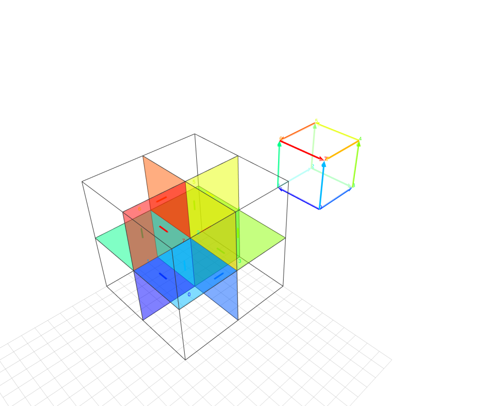

# Construct the dual volmesh of a force volmesh



```python title="examples/multi_cell_polyhedron/01_20_volmesh_duality_volmesh.py"
--8<-- "examples/multi_cell_polyhedron/01_20_volmesh_duality_volmesh.py"
```
