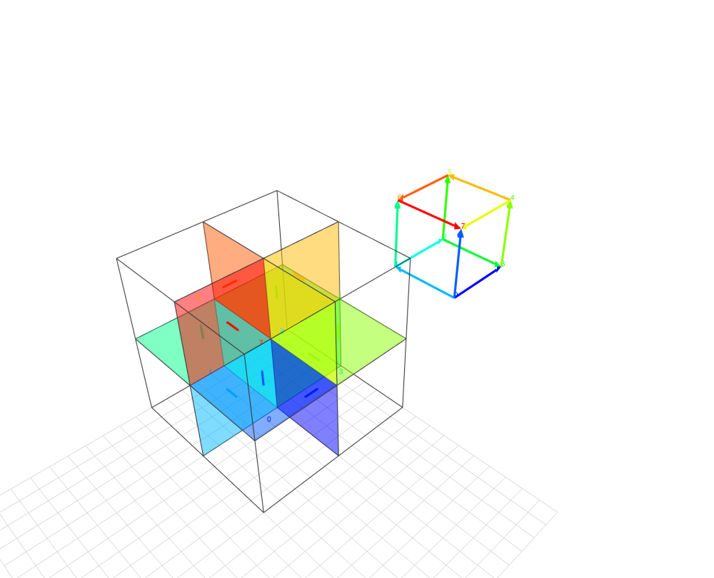

# Make the dual network of a force volmesh and show how their elements correspond

Every cell of the volmesh is a node of the dual network, and every interior face between two cells
is an edge. The directed edge (u, v) and the halfface of cell u that points to cell v are drawn in
the same colour, with the halfface normal as an arrow along the edge direction.



```python title="examples/multi_cell_polyhedron/01_21_volmesh_duality_network.py"
--8<-- "examples/multi_cell_polyhedron/01_21_volmesh_duality_network.py"
```
