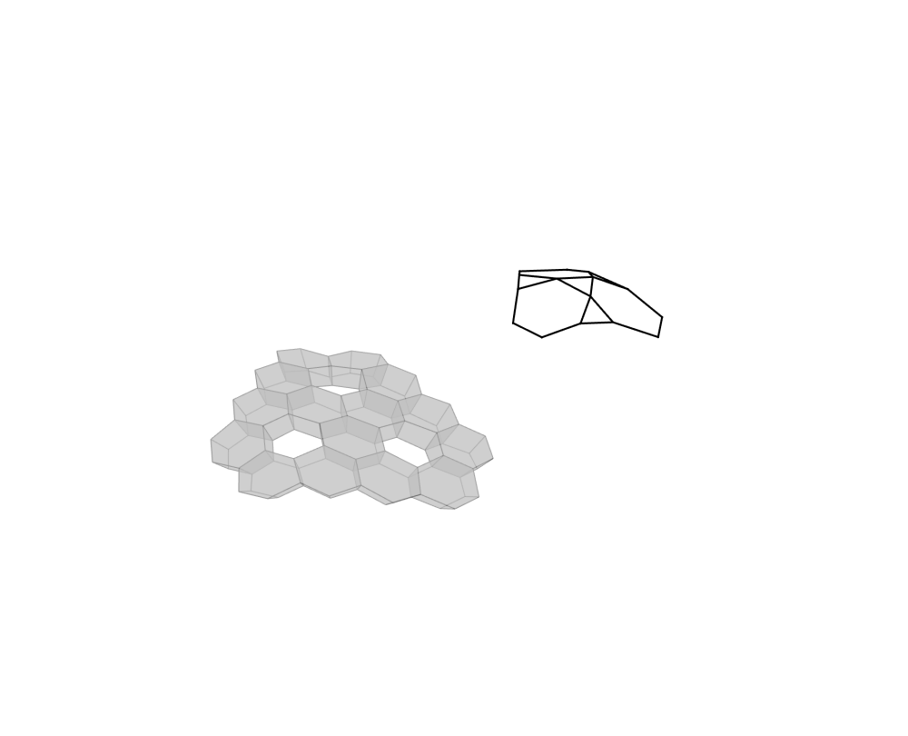

# Reciprocate a polyhedral force diagram and its form diagram

The form diagram is the dual network of the force diagram: one node per cell and one edge per
interior face. Reciprocation makes every form edge perpendicular to its face in the force diagram,
by moving the form diagram (WEIGHT = 1), the force diagram (WEIGHT = 0), or both (in between).



```python title="examples/multi_cell_polyhedron/01_30_volmesh_reciprocation.py"
--8<-- "examples/multi_cell_polyhedron/01_30_volmesh_reciprocation.py"
```
