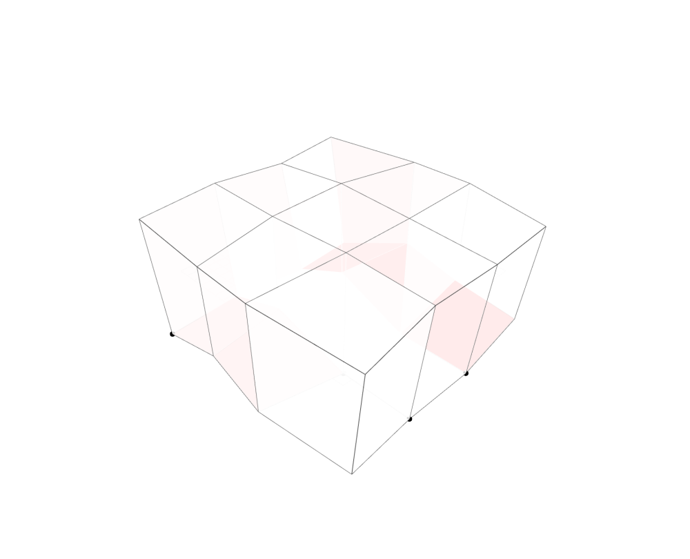

# Planarise the faces of a volmesh, with some of its vertices fixed

The faces are coloured by their flatness relative to the start: red is as warped as at the
start, white is flat. Faces that start flat (all interior faces among them) stay white, even
while the run warps them a little. The fixed vertices are the black points.



```python title="examples/multi_cell_polyhedron/01_40_volmesh_planarisation.py"
--8<-- "examples/multi_cell_polyhedron/01_40_volmesh_planarisation.py"
```
