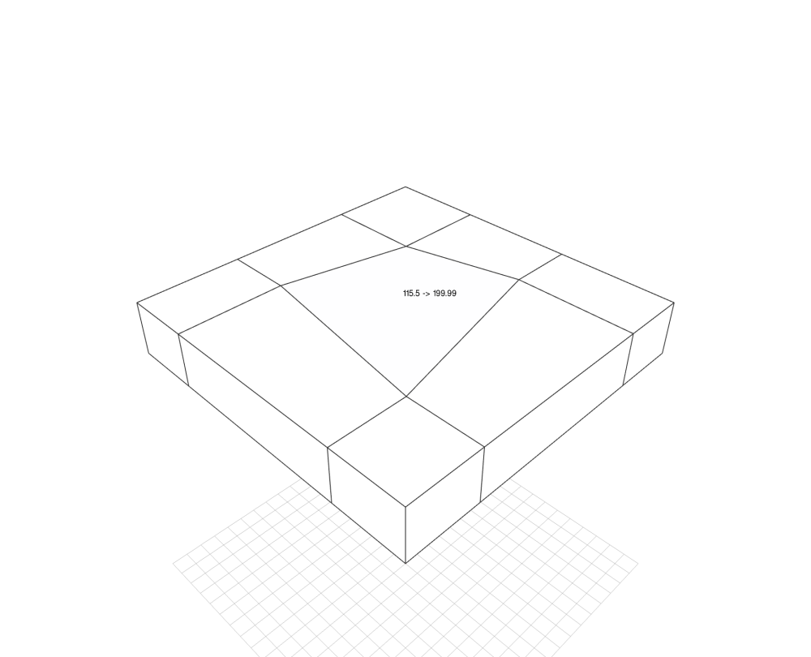

# Arearise chosen halffaces of a volmesh to a target area



```python title="examples/multi_cell_polyhedron/01_50_volmesh_arearisation.py"
--8<-- "examples/multi_cell_polyhedron/01_50_volmesh_arearisation.py"
```
