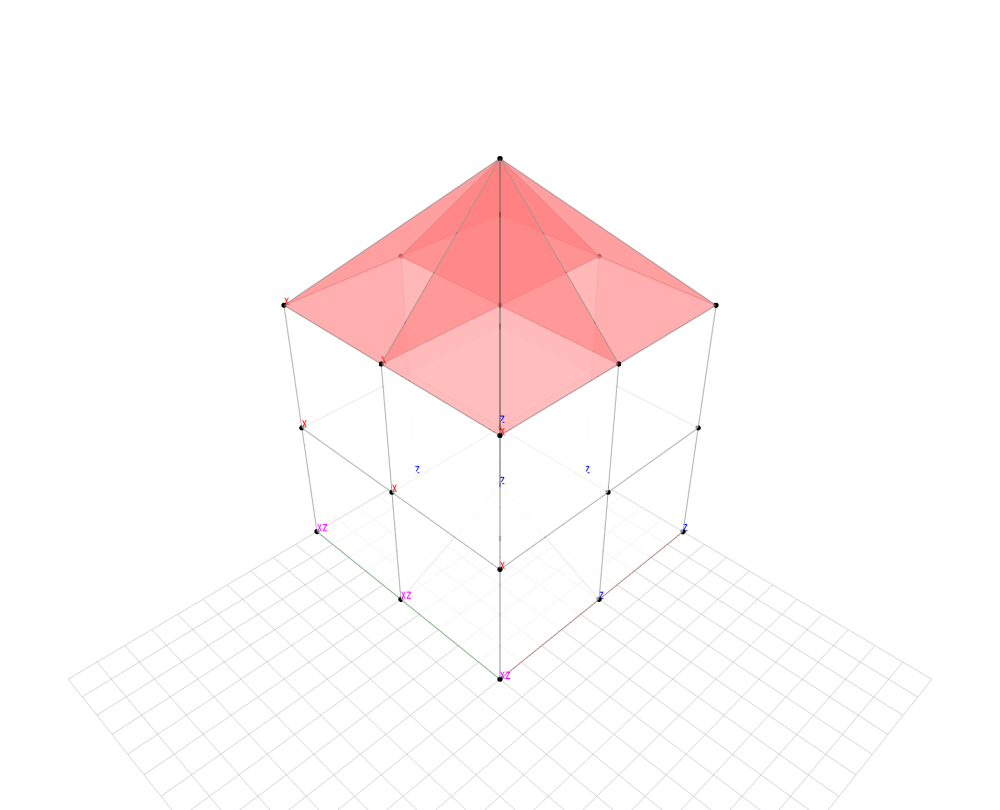

# Modify a polyhedral force diagram: set vertex fixities, move a vertex and lift a boundary vertex

A move keeps the fixed axes of the vertex: the moved bottom vertex stays in z = 0, so the bottom
stays flat (the vertical faces through it are warped). The lift adds a pyramid cell (red) on each
boundary halfface around the vertex. Every fixed vertex is labelled with its fixed axes, in red
for x, blue for z and magenta for both. The grey point is the requested position of the moved
vertex, and the arrow its constrained move.



```python title="examples/multi_cell_polyhedron/01_60_volmesh_modification.py"
--8<-- "examples/multi_cell_polyhedron/01_60_volmesh_modification.py"
```
