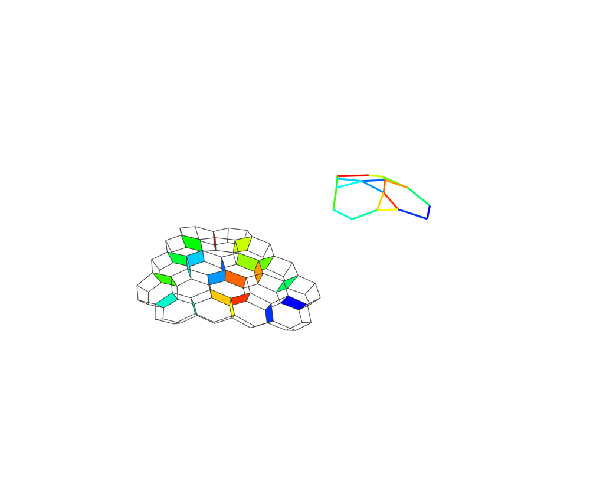

# Colour the corresponding elements of a polyhedral form and force diagram



```python title="examples/multi_cell_polyhedron/01_70_volmesh_color_id.py"
--8<-- "examples/multi_cell_polyhedron/01_70_volmesh_color_id.py"
```
