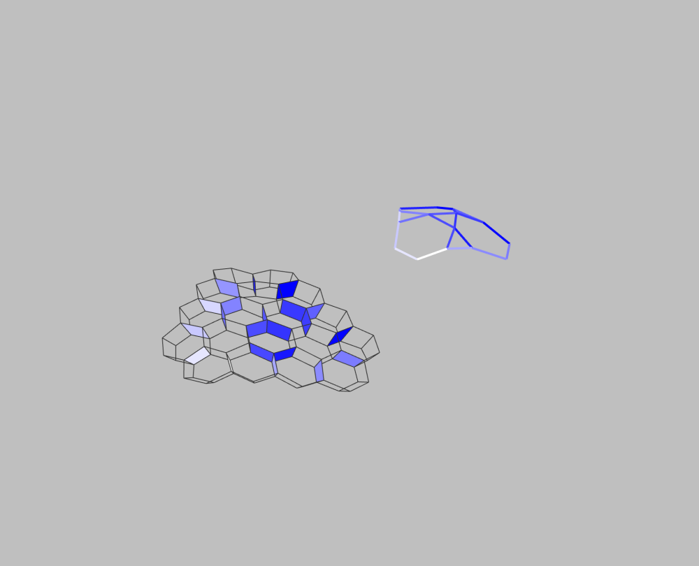

# Five ways to visualise a polyhedral force diagram and its reciprocal form diagram

DISPLAY picks one: "id" gives every form edge and its face in the force diagram the same colour,
"compression_tension" colours them by force (blue compression, red tension, darker is larger),
"pipes" draws every form edge as a pipe with a radius proportional to the area of its face,
"external_forces" draws the resultant of the boundary faces of every boundary cell as an arrow at
its node (white to green for small to large), and "internal_forces" draws the force of every edge as an
arrow at both of its nodes, pointing at the node for compression.



```python title="examples/multi_cell_polyhedron/01_71_volmesh_visualisation.py"
--8<-- "examples/multi_cell_polyhedron/01_71_volmesh_visualisation.py"
```
