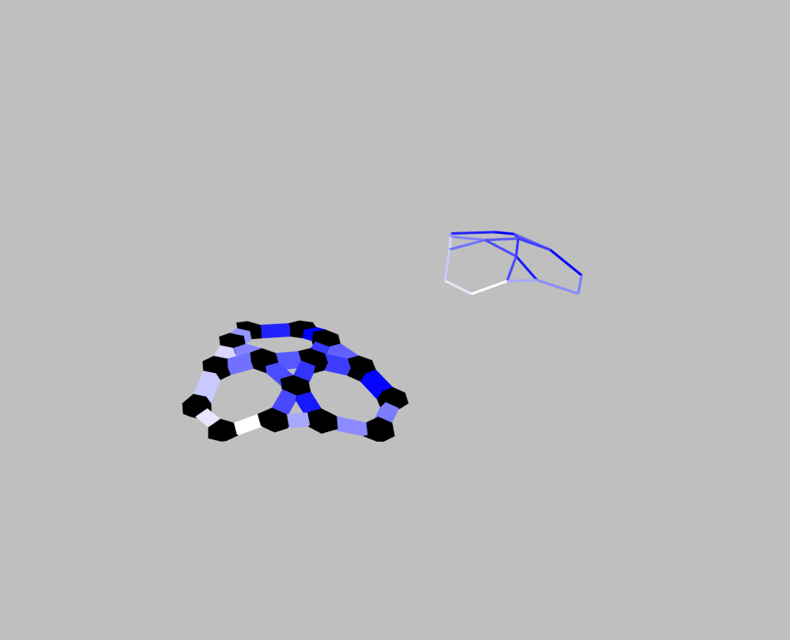

# Unified diagram of a multi-cell force diagram and its form diagram

The form diagram is reciprocated to the force diagram, then every cell is scaled towards its
form node and neighbouring cells are joined by prisms. The cells are black; the prisms and the
form edges are coloured by force magnitude (blue compression, red tension, darker is larger).
The smallest force is drawn white, so the background is grey.



```python title="examples/multi_cell_polyhedron/01_80_volmesh_unified_diagram.py"
--8<-- "examples/multi_cell_polyhedron/01_80_volmesh_unified_diagram.py"
```
