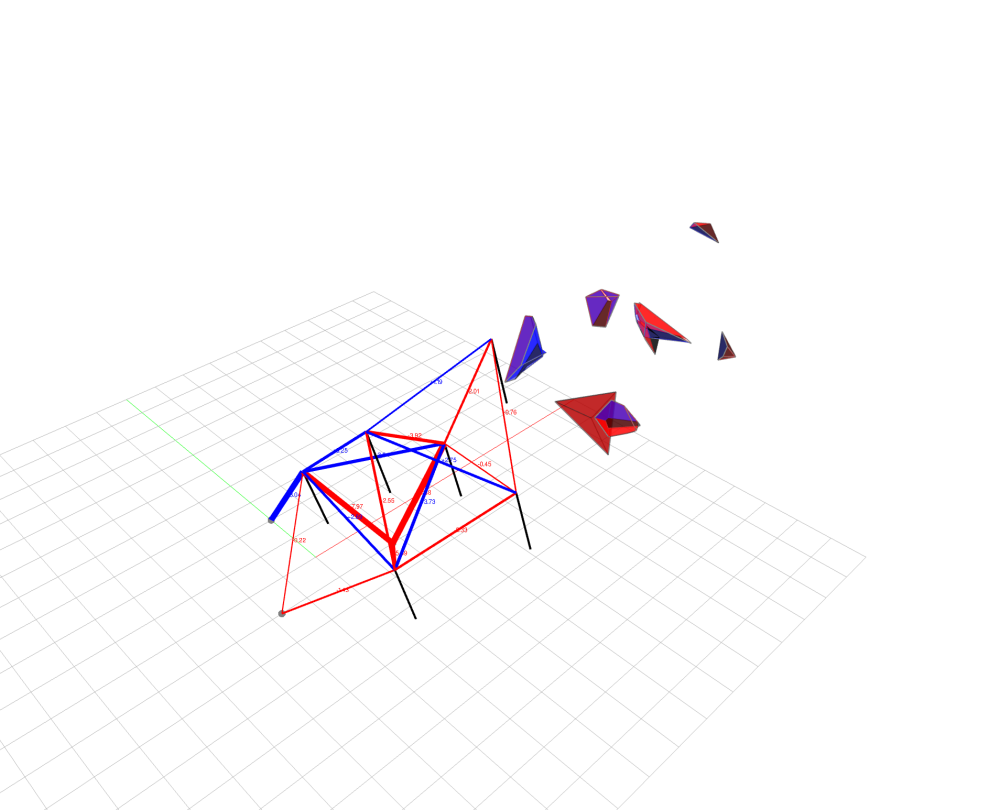

# A space truss tower (a tetrahelix) and one force polyhedron per node

Form diagram: a tower of tetrahedra on three pinned supports. Every new node is braced to the
three nodes below it, so the truss is statically determinate (3 equations per free node, 3 new
members per free node). Every free node carries gravity plus a horizontal wind load.

Force diagram: the "disjointed" 3GS approach. Each node gets its own closed polyhedral cell, with
one face per force at that node (members, load or reaction). A member appears in the cells of
both its nodes; equilibrium makes those two faces equal in area and parallel. Putting all node
cells together is what the 3GS cell network does.

Steps:
1. Solve the member forces with the equilibrium matrix (numpy), and the support reactions.
2. For every node with at least four forces that span 3D: EGI -> cell -> planarise to areas.
3. Check every face (area = force, normal parallel to force) and every member (same area in the
   cells of both its nodes).



```python title="examples/physical_structures/20_space_truss.py"
--8<-- "examples/physical_structures/20_space_truss.py"
```
