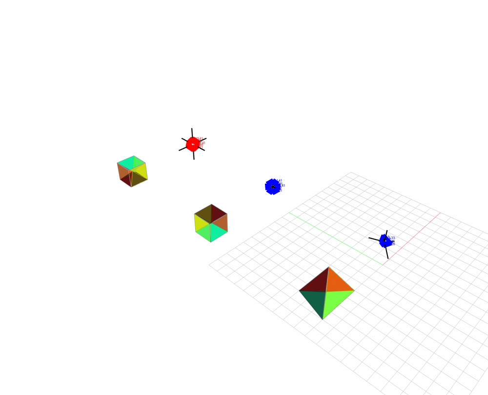

# Force first: design a polyhedral force diagram, get the space frame it stands for

This is how 3GS is meant to be used. The force diagram is a volmesh (cells sharing faces):

- each cell is a node of the structure;

- each interior face (shared by two cells) is a member: its area is the member force;

- each boundary face is an external force (load or reaction) on that node.
The form diagram (the space frame) is the dual network: one node per cell, one member per
interior face. Reciprocation makes every member perpendicular to its face.

Two force diagrams, both made with a 3GS operation (`volmesh_cell_subdivide_barycentric`):

- A. an irregular tetrahedron split into 4 cells around an inner point -> a tetrahedral frame
  (4 nodes, 6 members) under 4 external forces;

- B. a cube split into 6 pyramids -> an octahedral frame (6 nodes, 12 members) under 6 loads;

- C. the same force diagram after `point_reflection`: the face normals keep their direction while
  the cells turn inside out, so the dual frame carries the same forces in tension, with the loads
  pulling outward.

Checks: every member is perpendicular to its face, and every node is in equilibrium with the
member forces from `get_force_mags` and the loads from the boundary faces.



```python title="examples/physical_structures/30_force_first_frames.py"
--8<-- "examples/physical_structures/30_force_first_frames.py"
```
