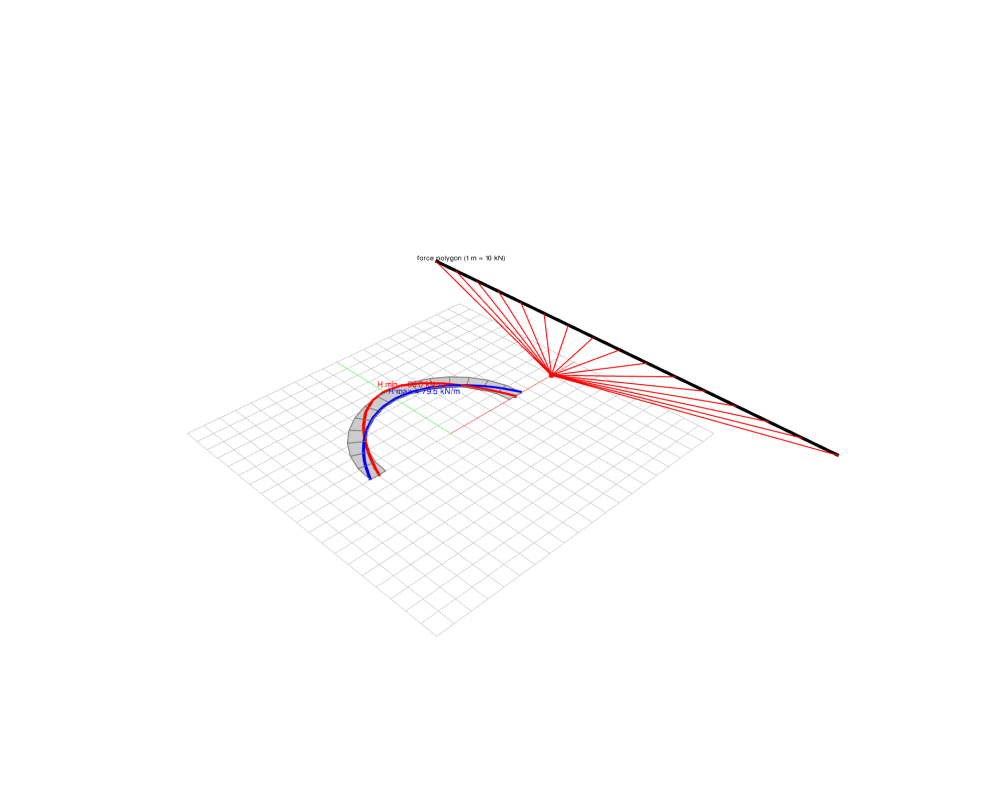

# Thrust line of a semicircular masonry arch, and what 3GS can and cannot do with it

1. The arch: a semicircle of voussoirs (unit depth); each voussoir weighs its area times DENSITY.
2. 3GS first: at every point of a thrust line, three forces meet (the thrust from the left, the
   thrust to the right, the weight). Three forces in equilibrium always lie in one plane, and a
   polyhedral cell needs forces that span 3D. So 3GS has no force polyhedron for an arch node:
   `egi_from_vectors` refuses fewer than four vectors, and four or more forces in one plane do not
   close a polyhedron either. The thrust line of a planar arch is 2D graphic statics.
3. The thrust line with 2D graphic statics: the funicular polygon of the voussoir weights for a
   horizontal thrust H, through points of the two springing joints at x = -d and +d. The arch is
   safe (Heyman) for every thrust line that stays inside the arch at every joint. Scanning H and d
   gives the range between the minimum and the maximum thrust.
4. Viewer: the arch, the thrust lines of the minimum and maximum thrust, and the force polygon
   (load line and rays from the pole) of the minimum-thrust state.

For thrust lines of 3D masonry (vaults, domes) the BRG tool is compas_tna (thrust network analysis);
3GS is for spatial structures where nodes have four or more forces that do not lie in one plane.



```python title="examples/physical_structures/40_arch_thrust_line.py"
--8<-- "examples/physical_structures/40_arch_thrust_line.py"
```
