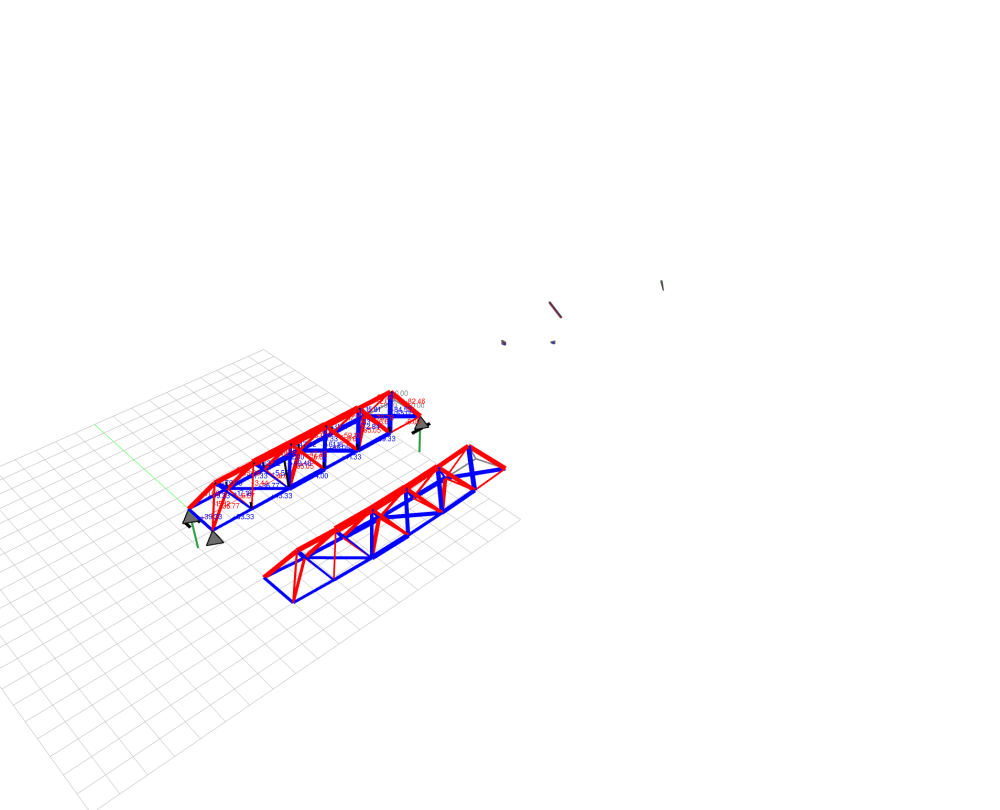

# A 3D Warren truss solved twice: with 3GS (`GSModel`, statics) and with a linear finite element model



```python title="examples/model/05_warren_truss_fem.py"
--8<-- "examples/model/05_warren_truss_fem.py"
```
