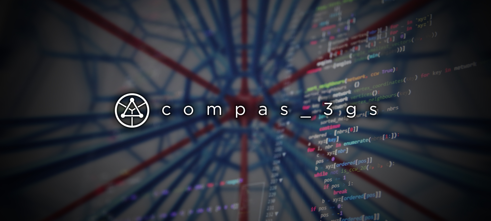
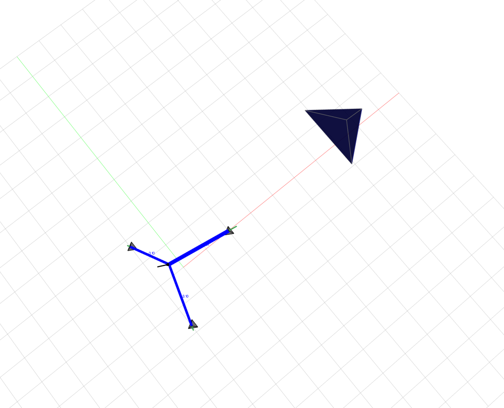

# compas_3gs

{width="100.0%"}

## About

`compas_3gs` is a 3D graphic statics add-on package for the [COMPAS](https://compas-dev.github.io/) framework.

Graphic statics is a graphical method of analysis and design of structures using reciprocal form and force diagrams.
Computational graphic statics is a powerful design tool that automates the drawing process of the reciprocal diagrams.
It also enables dynamic interaction and bi-directional control of both the geometry of form and internal forces of a structure, while providing a real-time, visual feedback.

In 2D graphic statics, the planar equilibrium of forces at a node of a structure is represented by a closed force polygon.
In 3D graphic statics, the spatial equilibrium of forces at a node of a structure is represented by a closed force polyhedron.
As structures become more complex, so does the topology and geometry of its force polyhedra.
Conventional CAD tools are limited in their functions and visualisation methods, which inhibit sufficient handling and modelling of polyhedral geometries.

The `compas_3gs` package provides the necessary datastructures, functionalities, algorithms and visualisation tools for a wide range of research and design applications using 3D raphic statics.
Using the `network`, `mesh` and `volmesh` datastructures, this packages aids the user in setting up and initialising polyhedral reciprocal diagrams.
Various algorithms allow precise control and transformation of the polyhedral form and force diagrams.
Most importantly, the legibility and usability of the polyhedral reciprocal diagrams are improved through various visualisation functionalities to provide the user with new design insights, which is one of the most rewarding inherent benefits of graphic statics.

<br>


------------------------------------------------------------------------

## General approach

The functionalities and algorithms of `compas_3gs` are mainly based on transparent, geometry-based solvers and optimisation techniques as opposed to “black-box,” numerical methods.
`compas_3gs` is developed with the following goals in mind:

<br>


**1. Flexibility**

The implementation needs to be general and flexible enough to cover a wide range of both known and unknown structural typologies.
It also needs to have as few software dependencies as possible, so that users from a variety of backgrounds and expertise can adapt the library for various applications regardless of the CAD software being used.

<br>


**2. Simplicity**

In computational geometry, improvement of the computational efficiency of solving procedures and algorithms are often prioritised over the user’s ability to modify and interact with the resulting solutions.
Instead of focusing on computing the absolute solution in the shortest amount of time possible, the solution as well as the procedure should communicate complex information in simple ways that are easy to understand and potentially provide meaningful insights.

<br>


**3. Customisability**

During early stages of design, it may be desirable to explore multiple
feasible solutions as rapidly as possible while meeting the requirements
that are specific to the design problem at hand.
This requires a set of flexible yet robust functions and operations, which can be easily mix-and-matched to create customised toolbars and workflows that are
tailored for the needs of the user.

<br>


**4. Open source**

`compas_3gs` is developed as an open-source library, encouraging researchers from a wide range of disciplines and expertise to make contributions that all users can benefit from.
In order to incentivise the researchers to contribute their work, each contribution to `compas_3gs` will be treated like a publication which can be cited and referenced.

------------------------------------------------------------------------

## A first model

A tripod: three legs from an apex to pinned feet, and a load at the apex. `GSModel` finds the leg
forces from equilibrium, and builds the force polyhedron of the apex: one face per force, normal to
the force and as large as its magnitude.

```python
from math import cos, radians, sin

from compas_3gs.model import GSModel
from compas_3gs.viewer import GSViewer

apex = [0.0, 0.0, 3.0]
feet = [[2.0 * cos(radians(a)), 2.0 * sin(radians(a)), 0.0] for a in (0, 120, 240)]

model = GSModel.from_lines([(apex, foot) for foot in feet])
for foot in feet:
    model.set_support(node=model.node_at(foot), dofs="pinned")
model.add_force(node=model.node_at(apex), vector=[1.5, 0.0, -10.0])

model.solve()                 # leg forces and reactions from equilibrium
model.derive_force_diagram()  # the force polyhedron of every node with four forces or more
print(model.summary())

viewer = GSViewer()
viewer.add_model(model)
viewer.show()
```

The legs carry −5.809, −3.105 and −3.105 kN (compression is negative). The feet have two forces
each, a leg and a reaction, so only the apex has a polyhedron; its faces match the forces to 0.001 %.


/// caption
The tripod in compression (blue) on its pinned supports, the load (black) and the reactions (green);
beside it the force polyhedron of the apex.
///

The [Tutorial](tutorial.md) goes through a complete analysis, the [User Guide](userguide/index.md)
explains graphic statics and the methods of the package, the [Examples](examples/index.md) cover
trusses, towers, domes, tensegrities and polyhedral force diagrams, and the
[API Reference](api/index.md) lists every class and function.
