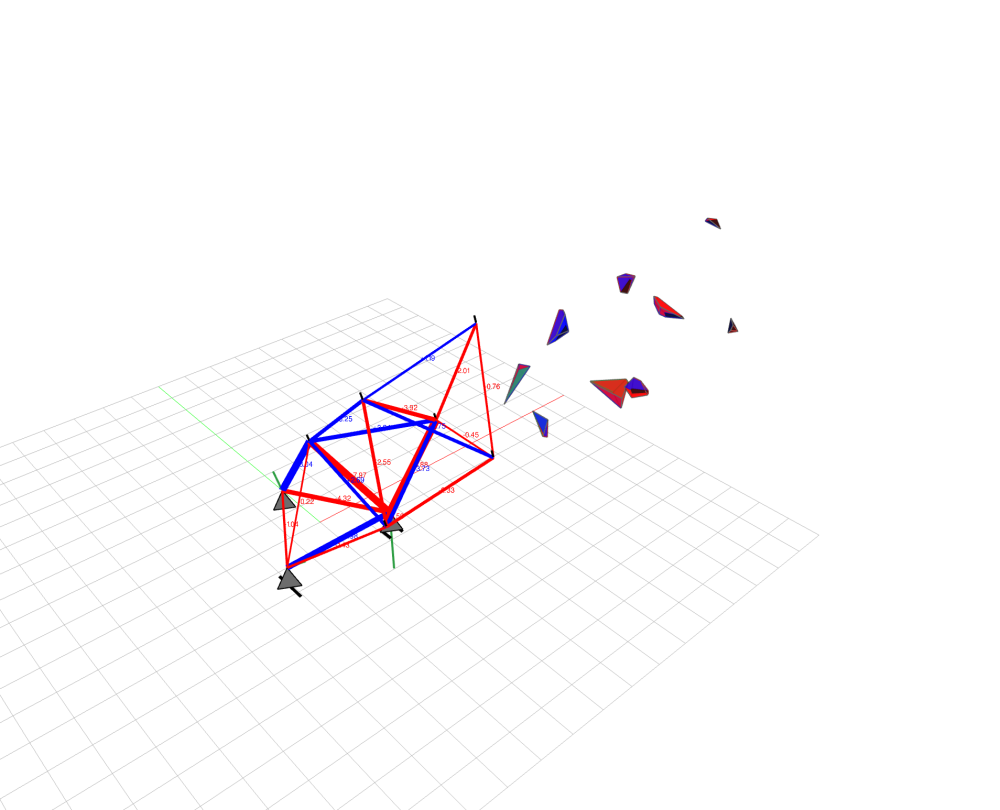

# Tutorial

This tutorial analyses a space truss: a tetrahelix tower of nine nodes and 21 members on a pinned, a
slider and a roller support, carrying a load at every node above the base. It finds the member
forces from equilibrium and builds the force diagram, one polyhedron per node. The code is that of
[A tetrahelix tower](examples/model_02_space_truss.md), split into five steps.
{ .lead }

## 1. Geometry

A model starts from the lines of its members. `GSModel.from_lines` joins them where their ends meet
and keeps the result as the form diagram, `model.form`, a `FormNetwork` (a compas `Graph`).

```python
from math import cos, radians, sin, sqrt

from compas.geometry import add_vectors, centroid_points, distance_point_point, scale_vector, subtract_vectors
from compas_3gs.model import GSModel

# a base triangle, a fourth node above it, and five more, each the reflection of the node three before it
xyz = [[2.0 * cos(radians(a)), 2.0 * sin(radians(a)), 0.0] for a in (90, 210, 330)]
side = distance_point_point(xyz[0], xyz[1])
xyz.append(add_vectors(centroid_points(xyz), [0.0, 0.0, side * sqrt(2.0 / 3.0)]))
for k in range(4, 9):
    xyz.append(subtract_vectors(scale_vector(add_vectors(add_vectors(xyz[k - 1], xyz[k - 2]), xyz[k - 3]), 2.0 / 3.0), xyz[k - 4]))

lines = [(xyz[0], xyz[1]), (xyz[1], xyz[2]), (xyz[2], xyz[0])]  # the base ring
lines += [(xyz[k], xyz[k - i]) for k in range(3, 9) for i in (1, 2, 3)]

model = GSModel.from_lines(lines)
```

The form diagram has 9 nodes and 21 members. Node and member keys come from the order of the lines;
`model.node_at(point)` finds the node at a point, so a script never needs to know them.

## 2. Supports and loads

A support restrains some directions of a node: `"pinned"` all three, `"slider"` x and z, `"roller"`
z only, or any axes as a string such as `"xz"`. A load is a vector added to a node.

```python
model.set_support(node=model.node_at(xyz[0]), dofs="pinned")
model.set_support(node=model.node_at(xyz[1]), dofs="xz")      # a slider, free along y
model.set_support(node=model.node_at(xyz[2]), dofs="roller")  # z only
for point in xyz[3:]:
    model.add_force(node=model.node_at(point), vector=[0.5, 0.0, -2.0])
```

The three supports have 3 + 2 + 1 = 6 reaction components, as many as the six ways a rigid body can
move: with the base ring, the tower stands on them without any reaction more than statics needs.
Supports and loads are node attributes of the form diagram (`support`, `px`, `py`, `pz`).

## 3. Equilibrium

`solve` writes the axial force of every member (edge attribute `_f`) and the reaction of every
support (node attributes `_rx`, `_ry`, `_rz`) into the form diagram.

```python
result = model.solve()
print(result.determinate, len(model.self_stresses))
print(model.summary())
```

The truss is statically determinate: each of the 9 nodes gives three equations, 27 in all, for 21
member forces and 6 reaction components, and none of them depend on the others (`determinate` is
`True`, there is no self-stress state). Statics alone fixes the forces: from −8.88 kN in the most
compressed member to +8.04 kN in the most stretched one (tension is positive). The vertical
reactions are −6.56, +0.95 and +17.61 kN: the pinned support holds the tower down against the
sideways load.

A truss with more members or reaction components than statics needs has self-stress states, and
`solve` then takes the member stiffness, or prescribed forces, to pick one of its states in
equilibrium: see [Solving](userguide/solving.md).

## 4. Force diagram

The force polyhedron of a node has one face per force on it, from a member, the load or the
reaction: the face is normal to the force and its area is the force's magnitude. The faces close
into a polyhedron because the forces are in equilibrium, and by Minkowski's theorem there is
exactly one convex polyhedron with these faces.

```python
model.derive_force_diagram()
for node, check in model.check().items():
    print(node, check["area_error"], check["angle"])
for node, reason in model.skipped.items():
    print(node, reason)
```

`model.cells` holds the polyhedron of each node and `model.cell_faces` what each face stands for (a
member, `"load"` or `"reaction"`). `check` measures how well every cell matches its forces: all
nine nodes get their polyhedron, its face areas within 10⁻⁹ of the forces and its normals along
them. A node with fewer than four forces, or with two forces in the same direction, would be listed
in `model.skipped` instead (see [Force polyhedra](userguide/force_polyhedra.md)).

## 5. Viewing

`GSViewer` draws the form diagram, its supports, loads and reactions, and the force polyhedra beside
it, each in a group of the scene tree.

```python
from compas_3gs.viewer import GSViewer

viewer = GSViewer()
viewer.add_model(model)
viewer.show()
```


/// caption
Members in compression red, in tension blue, thicker with a larger force; a glyph per support; the
force polyhedra of the nodes beside the truss.
///

Selecting a member, in the scene tree or in the view, shows its type (compression or tension), its
force and the force components in the info panel of the sidebar ([Viewing](userguide/viewing.md)).
