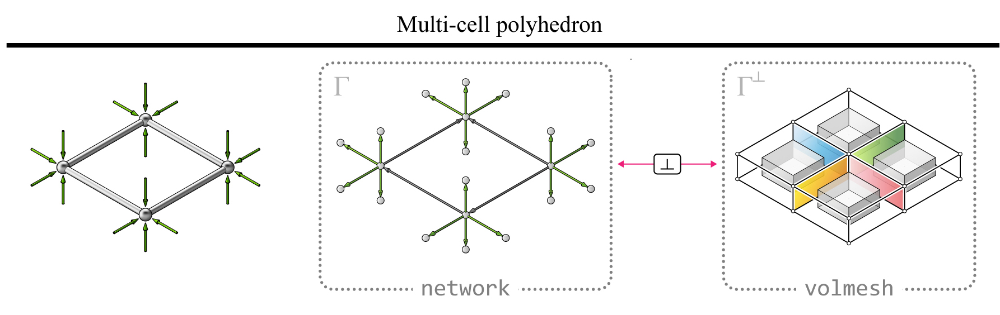
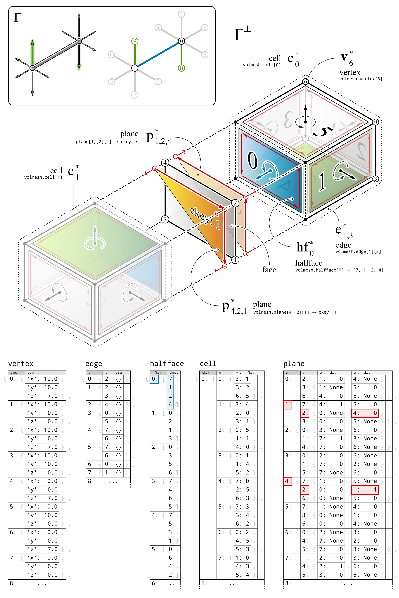

# Datastructure

A multi-cell polyhedron $\Gamma^{\perp}$ and its corresponding polyhedral form diagram $\Gamma$ are modelled as `volmesh` and `network`, respectively.
Because $\Gamma^{\perp}$ and $\Gamma$ are topologically dual to each other, $\Gamma$ can also be modelled as a `volmesh`.
However, because the topological information of $\Gamma$ is embedded in $\Gamma^{\perp}$, some information do not need to be duplicated.
For example, the face and cell information of $\Gamma$ can be computed from the topology of $\Gamma^{\perp}$.
The polyhedral form diagram $\Gamma$ as a `network` is essentially a visualisation of the cell connectivity information of $\Gamma^{\perp}$, where each edge of $\Gamma$ is perpendicular to its corresponding face of $\Gamma^{\perp}$.

{width="100.0%"}

 

------------------------------------------------------------------------

 

{width="100.0%"}
