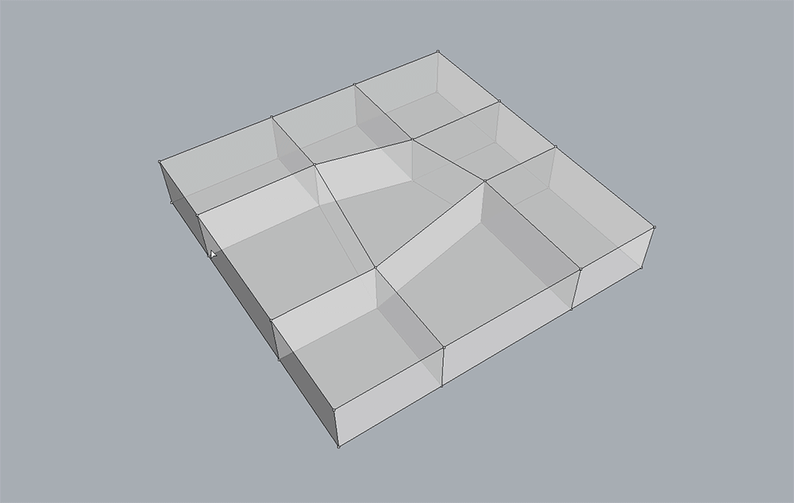

# Arearisation

Arearisation of a `volmesh` is implemented as a special case of the planarisation algorithm.
In addition to the planarisation of the faces by projection at each iteration step, they can be re-sized to match target areas.

<br>


------------------------------------------------------------------------

## Example

In this example, four randomly chosen faces are given new target areas.
The initial normals of all of the faces are constrained to remain unchanged.

{width="100.0%"}

<br>


<div class="card bg-light" markdown="1">
<div class="card-body" markdown="1">
<div class="card-title">Downloads</div>

- [volmesh_mat.3dm](../../assets/downloads/volmesh_mat.3dm)

</div>
</div>

```python
--8<-- "examples/rhino/old_examples/01_50_volmesh_arearisation.py"
```
