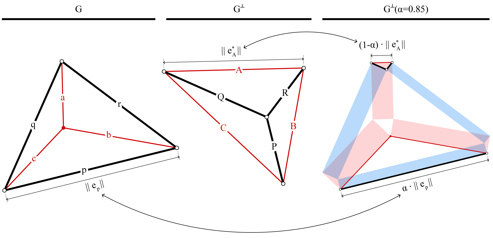
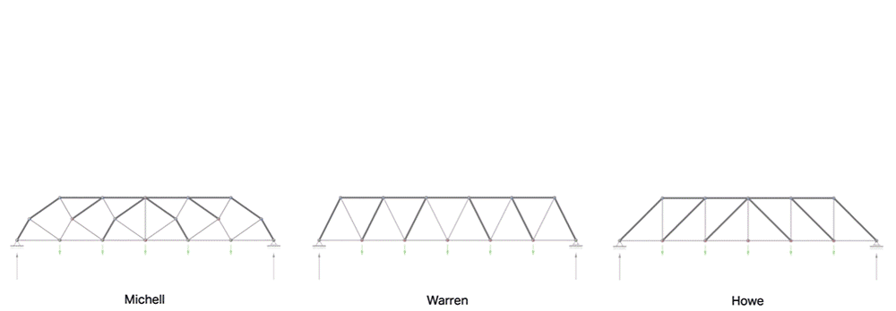
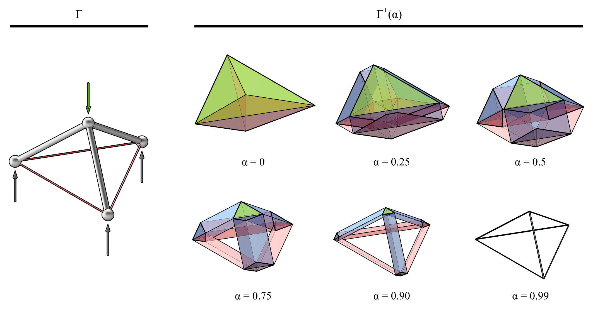
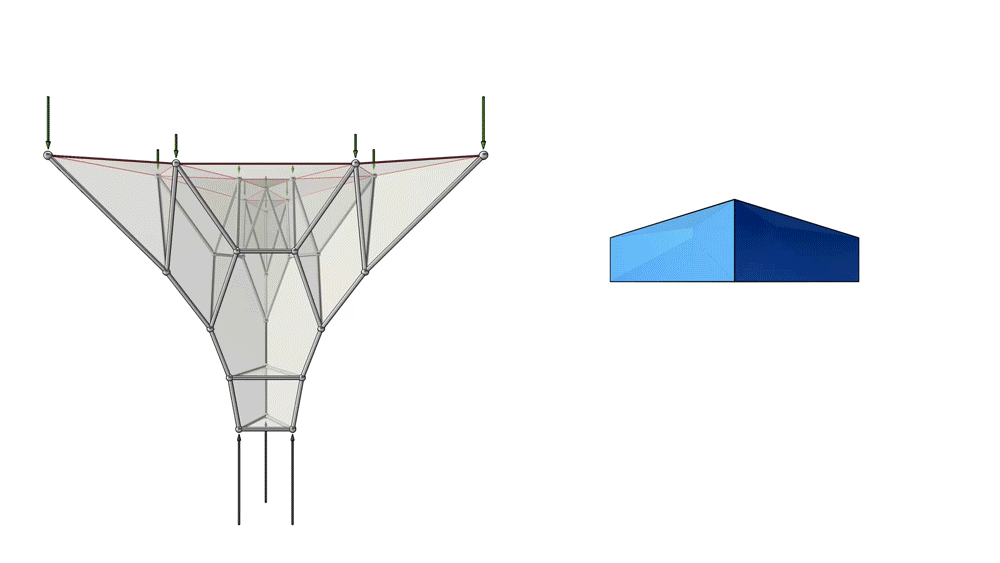
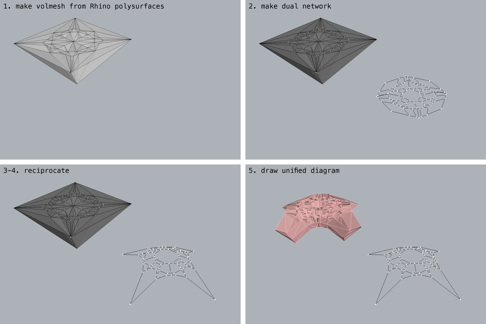

# Unified diagram

## Background

A *unified diagram* represents both the geometry and internal forces of a structure in a single diagram, thereby improving the legibility of reciprocal diagrams ([^1]).
In a unified diagram, the constituent polygons or cells of either the force diagram are scaled relative to the coordinates of the corresponding nodes in the form diagram, resulting in an "exploded view" of the force diagram.
Each pair of neighbouring polygons of a 2D unified diagram are connected by interstitial rectangles, whereas each pair of neighbouring cells of a 3D unified diagram are connected by interstitial prisms.

{width="100.0%"}
/// caption
Form diagram $G$, the reciprocal force diagram $G^\perp$ and the unified diagram $G^{\perp}({\alpha})$ for a simple truss (After[^2]).
///

------------------------------------------------------------------------

<br>


In contrast to traditional, side-by-side representation of form and force diagrams, the unique visualisation method of unified diagrams provide new insights and perspectives.
Unified diagrams are not only more discernible, but also provide an interesting visual representation of the volume of material required for a uniform stress design ([^2]).
Furthermore, the unified diagram reveals visual insights in relation to some of the most fundamental principles of structural engineering and analysis, such as: kinematics and mechanisms ([^1]); virtual work and displacements ([^6]); and stress-fields and strut-and-tie models ([^7],[^8]).

{width="100.0%"}
/// caption
Animation of unified diagrams for 2D trusses with varying scale factor $\alpha$.
///

{width="100.0%"}
/// caption
A simple 3D truss and its unified diagram: $\Gamma$ of the truss, which is equivalent to $\Gamma^{\perp}({\alpha}=1)$; and the $\Gamma^{\perp}({\alpha})$ with varying scaling factor of $\alpha$.
///

{width="100.0%"}
/// caption
Animation of the unified diagram for a compression-only spatially branching structure.
///

------------------------------------------------------------------------

## Example

{width="100.0%"}

<br>


<div class="card bg-light" markdown="1">
<div class="card-body" markdown="1">
<div class="card-title">Download</div>

- [volmesh_shells.3dm](../../assets/downloads/volmesh_shells.3dm)

</div>
</div>

```python
--8<-- "examples/rhino/old_examples/01_80_volmesh_unified_diagram.py"
```

<br>


------------------------------------------------------------------------

## References

[^1]: Zanni G. and Pennock G.R. (2009). *A unified graphical approach to the static analysis of axially loaded structures*. Mechanism and Machine Theory 44(12), 2187 – 2203.

[^2]: McRobie A. (2016). *Maxwell and rankine reciprocal diagrams via minkowski sums for two-dimensional and three-dimensional trusses under load*. International Journal of Space Structures 31(2-4), 203–216.

[^6]: McRobie A., Konstantatou M., Athanasopoulos G., and Hannigan L. (2017). *Graphic kinematics, visual virtual work and elastographics*. Royal Society Open Science 4(5).

[^7]: Schlaich M. and Anagnostou G. (1990). *Stress fields for nodes of strut-andtie models.* Journal of Structural Engineering 116 (1), 13–23.

[^8]: Muttoni A., Schwartz J., and Thürlimann B. (1997). *Design of Concrete Structures with Stress Fields*. Birkhäuser Basel.
